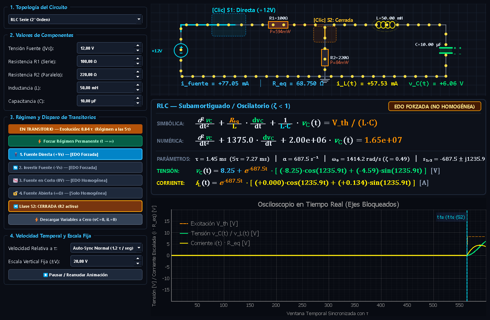

# Simulador Interactivo de Transitorios RLC

Aplicación de escritorio interactiva en Python (**PyQt5 + pyqtgraph + numpy**) para la simulación, análisis y visualización en tiempo real de circuitos de **1° y 2° orden**:
* **RLC Serie** (Sobreamortiguado, Críticamente Amortiguado, Subamortiguado / Oscilatorio, Oscilador LC Puro $\alpha = 0$)
* **RLC Paralelo**
* **RC Serie**
* **RL Serie**



---

## Características Principales

1. **Motor Físico y Matemático Exacto:**
   - Conservación estricta de continuidad de variables de estado físicas: $v_C(0^+) = v_C(0^-)$ e $i_L(0^+) = i_L(0^-)$.
   - Cálculo dinámico de equivalentes de Thévenin/Norton ($V_{th}, R_{eq}$).
   - Pizarra de **Ecuaciones Diferenciales Ordinarias (EDO)** con fracciones apiladas verticales sin colisiones tipográficas.
   - Distinción entre **Respuesta Forzada** y **Respuesta Homogénea Pura** ante cada conmutación.
   - Solución analítica temporal cerrada $v(t)$ e $i(t)$ y parámetros característicos ($\tau, \alpha, \omega_0, \zeta, s_{1,2}$).

2. **Esquemático Interactivo con Animación de Partículas por Conductor:**
   - Flujo de corriente física independiente sobre cada tramo de cable satisfaciendo las Leyes de Kirchhoff (KCL).
   - Indicadores visuales en componentes: disipación térmica y potencia en resistencias ($R_1, R_2$), carga electrostática en placas del capacitor ($v_C$) y campo magnético dinámico en inductores ($i_L$).
   - Interacción directa mediante clics sobre los conmutadores $S_1$ y $S_2$ en el propio circuito.

3. **Osciloscopio en Tiempo Real:**
   - Visualización simultánea de tensión en capacitor/inductor, corriente escalada $i(t) \cdot R_{eq}$ y excitación $V_{th}$.
   - Marcadores verticales de transitorios que registran el instante exacto de conmutación ($t_0$).
   - Ejes con escala fija protegidos contra arrastre o zoom accidental.

4. **Conmutación Controlada de Fuente:**
   - `1. Fuente Directa (+Vs)` — EDO Forzada directa.
   - `2. Invertir Fuente (-Vs)` — EDO Forzada con inversión de polaridad.
   - `3. Fuente en Corto (0V)` — EDO Homogénea con resistencia de entrada a masa.
   - `4. Fuente Abierta (∞Ω)` — EDO Homogénea pura sin rama de alimentación.
   - Inserción/desconexión de carga de perturbación $R_2$.
   - Forzar Régimen Permanente ($t \to \infty$) o descarga a cero ($v_C=0, i_L=0$).

---

## Instalación y Ejecución

### Requisitos Previos
* Python 3.9 o superior

### Instalación de Dependencias
```bash
pip install -r requirements.txt
```

### Ejecutar la Aplicación
```bash
python main.py
```

### Compilar a Ejecutable Standalone (.exe)
Para compilar un binario ejecutable único con PyInstaller:
```bash
pip install pyinstaller
pyinstaller --noconsole --onefile --exclude-module PyQt6 --name "Simulador_RLC" main.py
```
El ejecutable resultante se encontrará en la carpeta `dist/Simulador_RLC.exe`.

---

## Licencia
Proyecto distribuido bajo la Licencia MIT.
